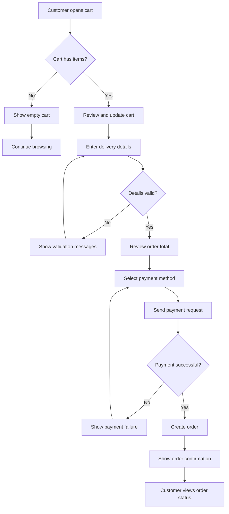

# Proposed Checkout Process

The flow below describes the basic customer journey for the first release.

## Process notes

- The customer can return to the cart and change items before payment.
- Delivery details must pass validation before the payment step.
- The final payable amount is shown before the payment request.
- The order is confirmed only after a successful payment response.
- A failed or cancelled payment returns the customer to the payment step.

## Items to confirm with stakeholders

- Whether cash on delivery is supported.
- How stock is reserved during checkout.
- What happens if payment succeeds but the store does not receive the response.
- Which order statuses are visible to customers.
